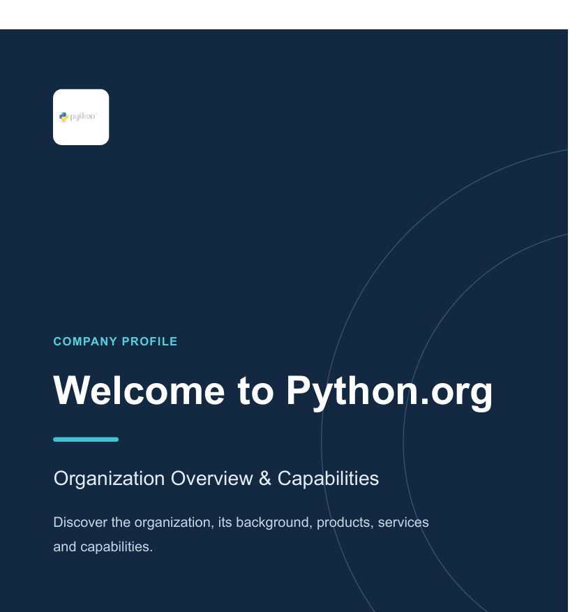
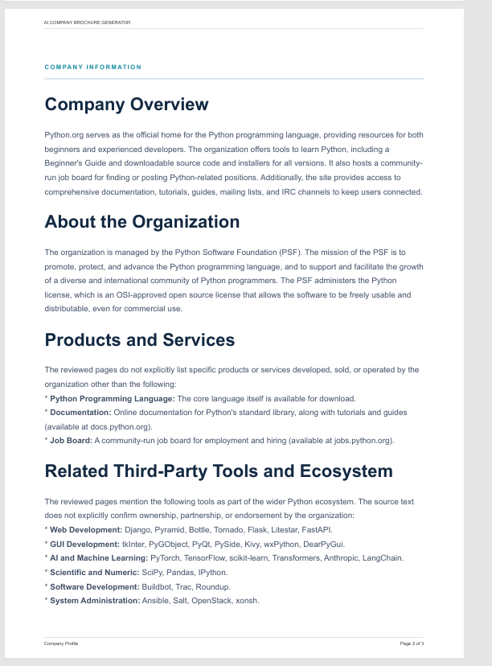

# AI Company Brochure Generator

An AI-powered Python application that turns information from a public company website into a professionally formatted, downloadable PDF brochure. It uses Streamlit for the interface, Requests and BeautifulSoup for website extraction, Ollama with the `qwen3.5:4b` model for brochure writing, and Playwright to render the final PDF.

## Screenshots

### Brochure cover page



### Brochure content page



## Features

- **Website URL input:** Enter a public company website URL in the Streamlit interface.
- **Multi-page website extraction:** Collects the homepage and selected same-domain pages, such as About, Services, Products, Contact, and Mission/Vision pages when matching links are available.
- **Company logo detection:** Looks for likely logo images on the homepage and uses an available logo in the PDF cover. A fallback mark is used when a logo cannot be found.
- **Local AI brochure generation:** Uses Ollama and the `qwen3.5:4b` model to draft structured brochure content from the collected website text.
- **Source-aware sections:** Organizes the brochure into company overview, organization background, products and services, related third-party tools, capabilities, contact information, and source pages.
- **Professional PDF layout:** Creates an A4 PDF with a cover page, styled content, header, footer, and page numbers.
- **PDF download:** Download the generated brochure from the Streamlit interface.

> AI-generated content can still contain errors or misunderstand source material. Review important claims against the original website before sharing the brochure.

## Technology Stack

| Area | Technology |
|---|---|
| Programming language | Python |
| User interface | Streamlit |
| Website requests | Requests |
| HTML parsing | BeautifulSoup4 |
| Local language model | Ollama – `qwen3.5:4b` |
| Markdown rendering | Python-Markdown |
| PDF rendering | Playwright with Chromium |
| Brochure layout | HTML and CSS |

## Project Structure

```text
AI-Brochure-Generator/
├── ai/
│   ├── __init__.py
│   └── content_generator.py
├── brochure/
│   ├── __init__.py
│   ├── style.css
│   └── template.html
├── pdf/
│   ├── __init__.py
│   └── pdf_generator.py
├── scraper/
│   ├── __init__.py
│   ├── multi_page_scraper.py
│   ├── page_navigator.py
│   └── website_scraper.py
├── utils/
│   └── helpers.py
├── screenshots/
│   ├── cover-page.png
│   └── brochure-content.png
├── app.py
├── requirements.txt
├── .gitignore
└── README.md
```

## Requirements

- Python installed and available from the terminal.
- Ollama installed and running locally.
- The `qwen3.5:4b` model downloaded in Ollama.
- An internet connection to read permitted public website pages and install dependencies.

## Installation and Setup (Windows)

### 1. Clone the repository

```cmd
git clone https://github.com/shaikfarzana2004-sketch/AI-Brochure-Generator.git
```

### 2. Open the project folder

```cmd
cd AI-Brochure-Generator
```

### 3. Create a Python virtual environment

```cmd
python -m venv venv
```

### 4. Activate the virtual environment

```cmd
venv\Scripts\activate
```

### 5. Install Python dependencies

```cmd
python -m pip install --upgrade pip
pip install -r requirements.txt
```

### 6. Install the Playwright Chromium browser

```cmd
python -m playwright install chromium
```

### 7. Install and prepare Ollama

Install Ollama from [ollama.com/download](https://ollama.com/download), then download the model used by this project:

```cmd
ollama pull qwen3.5:4b
```

Make sure Ollama is running before generating a brochure. You can check that the model is available with:

```cmd
ollama list
```

If the Ollama server is not already running, start it in a separate terminal:

```cmd
ollama serve
```

### 8. Run the Streamlit application

From the project folder, with the virtual environment activated:

```cmd
streamlit run app.py
```

Open the local address printed in the terminal. The default is:

```text
http://localhost:8501
```

## How to Use

1. Start Ollama and make sure `qwen3.5:4b` is available.
2. Start the Streamlit application with `streamlit run app.py`.
3. Enter a public company website URL, for example `https://www.python.org/`.
4. Select **Generate Brochure**.
5. Wait while the application collects website pages, checks for a logo, and generates brochure content.
6. Review the brochure preview and check important facts against the source website.
7. Select **Download Company Brochure PDF** to save the PDF.

## How It Works

```text
Company website URL
        │
        ▼
Website scraper
(Requests + BeautifulSoup)
        │
        ├──► Selected internal pages
        │
        └──► Homepage logo detection
        │
        ▼
Source text preparation
        │
        ▼
Ollama (qwen3.5:4b)
        │
        ▼
Structured brochure content (Markdown)
        │
        ▼
HTML template + CSS styling
        │
        ▼
Playwright / Chromium PDF rendering
        │
        ▼
Downloadable company brochure PDF
```

## Troubleshooting

### Ollama connection error

- Make sure Ollama is installed and running.
- Check the model with `ollama list`.
- If needed, download it with `ollama pull qwen3.5:4b`.

### Model not found

Run:

```cmd
ollama pull qwen3.5:4b
```

### Playwright or Chromium error

Run:

```cmd
python -m playwright install chromium
```

### Website pages are not collected

- Check that the URL is correct and publicly accessible.
- Some websites rely heavily on JavaScript or block automated requests, so their content may not be available to this simple scraper.
- Only use websites that you are permitted to access.

### Company logo is not displayed

Some sites do not expose a logo in a standard image element or favicon. The application uses a fallback logo mark when it cannot find a suitable image.

## Responsible Use

- Use this application only with public website pages that you are permitted to access.
- Respect the website's terms, crawling rules, and rate limits.
- Do not use the application to bypass logins, paywalls, CAPTCHAs, or other access controls.
- Check the generated brochure for accuracy and confirm important claims with the original source pages before publishing or distributing it.

## Author

**Shaik Farzana**  
GitHub: [shaikfarzana2004-sketch](https://github.com/shaikfarzana2004-sketch)

## Repository

[AI Company Brochure Generator on GitHub](https://github.com/shaikfarzana2004-sketch/AI-Brochure-Generator)
